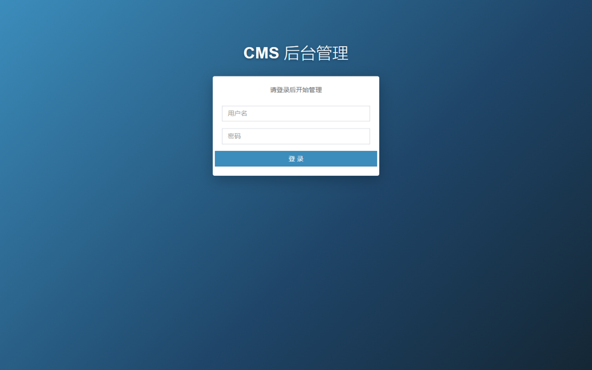
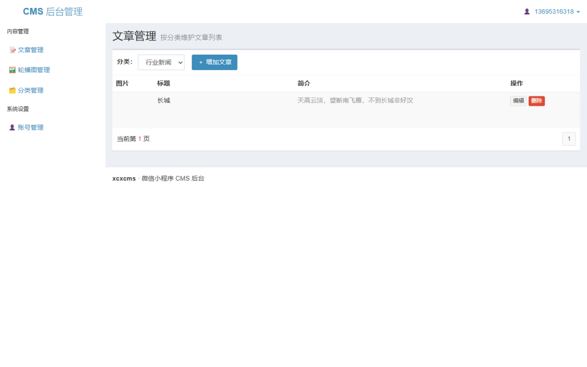
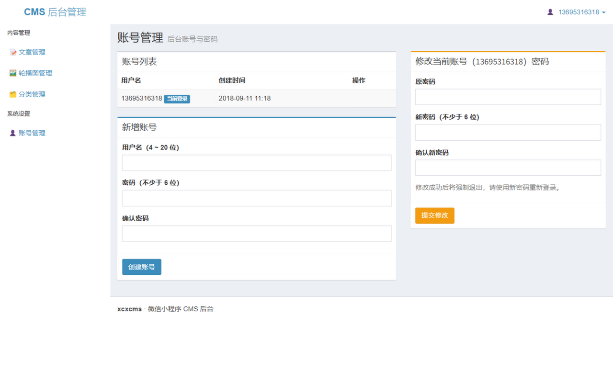
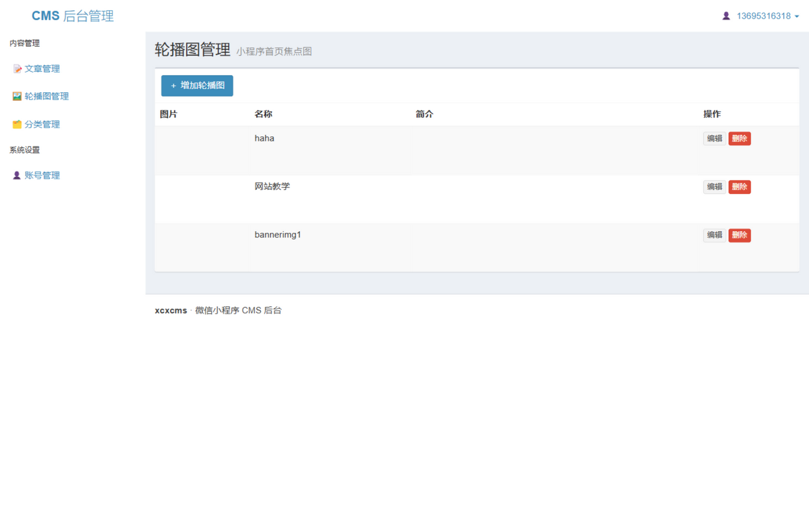

<div align="center">

# xcxcms

**微信小程序 CMS 系统** —— Java 后台（管理端 + 小程序接口）+ 微信小程序客户端

一个轻量的资讯/内容管理方案：后台维护分类、文章与轮播图，小程序端展示列表与详情。

[](#构建与测试)
[](#环境要求)
[](#技术栈)
[](#技术栈)
[](#环境要求)

**已通过端到端验证**：登录鉴权 · CRUD · 图片上传 · 安全加固 · 单元测试 · 界面截图核验

</div>

---

## 目录

- [界面预览](#界面预览)
- [项目结构](#项目结构)
- [技术栈](#技术栈)
- [快速开始](#快速开始)
- [后台功能](#后台功能)
- [小程序数据接口](#小程序数据接口)
- [小程序端配置](#小程序端配置)
- [生产部署](#生产部署)
- [构建与测试](#构建与测试)
- [常见问题](#常见问题)
- [完善说明](#完善说明)

## 界面预览

| 登录 | 文章管理 |
| --- | --- |
|  |  |
| **账号管理** | **轮播图管理** |
|  |  |

> 后台基于 AdminLTE + Bootstrap 3，全部页面已实测；截图见 [docs/screenshots](docs/screenshots)。

## 项目结构

```
xcxcms
├── cms-client/                 微信小程序客户端（微信开发者工具直接导入）
│   ├── pages/index/            首页：轮播图 + 分类 Tab + 文章列表（上拉/下拉刷新）
│   └── pages/article/          文章详情（rich-text 渲染）
├── cms-server/cms/             Java 后台（Spring MVC + MyBatis，可 Maven 构建）
│   ├── src/                    Java 源码与 Spring/MyBatis 配置
│   ├── test/                   JUnit 单元测试
│   ├── web/                    JSP 页面、静态资源、上传目录 img/
│   ├── web/WEB-INF/lib/        离线 jar（Eclipse 老工程方式使用；Maven 构建不打包）
│   └── pom.xml                 Maven 构建配置（推荐）
├── cms.sql                     MySQL 初始化脚本（建库 + 表 + 演示数据 + 索引）
├── docs/
│   ├── CHANGELOG.md            完善记录（修复/加固/功能/工程化明细）
│   └── screenshots/            后台界面截图
└── .github/workflows/ci.yml    CI（JDK 8/17 矩阵构建）
```

## 技术栈

| 层 | 选型 |
| --- | --- |
| Web 框架 | Spring MVC 4.3.3（JSP + JSTL） |
| 持久层 | MyBatis 3.2.8 + mybatis-spring 1.2.4 |
| 连接池 | Druid 1.0.9 |
| 数据库 | MySQL 5.5+（兼容 MariaDB） |
| 序列化 | fastjson 1.2.83 |
| 后台 UI | AdminLTE 2.3.6 + Bootstrap 3.3.6 |
| 构建 | Maven（war，`--release 8`）/ Eclipse 老工程两种方式 |
| 测试 | JUnit 4.13.2 |

## 快速开始

### 环境要求

- JDK 8+（已在 JDK 8 / 17 / 24 上验证编译运行）
- Maven 3.6+（推荐；也可用 Eclipse/IDEA 导入老工程）
- Tomcat **8 或 9**（Tomcat 10+ 为 jakarta 命名空间，不兼容 Spring 4）
- MySQL 5.5+ / 微信开发者工具

### ① 初始化数据库

```bash
mysql -uroot -p < cms.sql
```

脚本自动创建 `weichatarticle` 库、三张表（账号 / 分类 / 文章）及演示数据。

### ② 修改三处配置

| 文件 | 配置 | 说明 |
| --- | --- | --- |
| `cms-server/cms/src/config/resource/db.properties` | `jdbc.url` / `username` / `password` | 本机 MySQL 连接信息 |
| `cms-server/cms/src/com/ht/weichat/utils/ConstantPool.java` | `IP` | 服务端对外地址（含上下文路径），用于拼接图片完整 URL。本地调试 `http://localhost:8080/cms`，线上改 `https://域名/cms` |
| `cms-client/app.js` | `ROOT_URL` | 小程序请求的后台地址，与上一致（末尾带 `/`） |

### ③ 构建并启动

```bash
cd cms-server/cms
mvn clean package
cp target/cms.war $TOMCAT_HOME/webapps/   # Windows: copy 到 webapps\
$TOMCAT_HOME/bin/startup.sh               # Windows: startup.bat
```

访问 **http://localhost:8080/cms/** 进入后台。

> **默认账号**：`13695316318` / `123456`（登录后右上角可修改密码、管理账号）

### ④ 运行小程序

1. 微信开发者工具导入 `cms-client/` 目录
2. 详情 → 本地设置 → 勾选**「不校验合法域名」**（本地 http 调试必需）
3. `project.config.json` 中的 `appid` 请替换为自己的测试号 appid

## 后台功能

| 模块 | 说明 |
| --- | --- |
| 文章管理 | 按分类分页、图片上传（白名单校验）、权重排序、简介预览 |
| 轮播图管理 | 独立维护小程序首页焦点图 |
| 分类管理 | 增删改、权重排序（小程序首页 Tab 顺序） |
| 账号管理 | 账号列表 / 新增 / 删除 / 修改密码（原密码校验，改后强制重登） |
| 安全 | 登录拦截、连续失败 5 次锁定 10 分钟、XSS 转义、上传白名单、友好错误页 |

## 小程序数据接口

所有接口 GET，返回 JSON（UTF-8）。

| 接口 | 说明 |
| --- | --- |
| `GET /api/list` | 轮播图列表 |
| `GET /api/listApiType` | 分类列表（按权重排序） |
| `GET /api/listApiArticle?id={分类id}&loadTime={页码-1}` | 分类文章分页，每页 15 条，`loadTime` 从 0 递增 |
| `GET /api/findByIdApi?id={文章id}` | 文章详情（含 `date` 字段；不存在时 HTTP 404） |

<details>
<summary>响应示例</summary>

```jsonc
// GET /api/findByIdApi?id=2
{
  "id": 2,
  "pid": 1,
  "title": "cms小程序上线啦",
  "content": "微信小程序版的cms系统 上线啦",
  "imgurl": "http://localhost:8080/cms/img/fe32f07a-....png",
  "isbanner": false,
  "updattime": "2018-09-17 18:51:59",
  "date": "2018-09-17"
}

// 文章不存在时
HTTP 404  {"error": "article not found"}

// GET /api/listApiArticle?id=1&loadTime=0
[
  { "id": 9, "title": "...", "content": "最多50字预览…", "imgurl": "http://…", "updattime": "2026-11-10 01:02:03", … }
]
```

图片地址由服务端拼接为完整 URL（`ConstantPool.IP` + `/img/xxx`）。

</details>

## 生产部署

1. `mvn clean package` 得到 `target/cms.war`，放入 Tomcat `webapps/`
2. `ConstantPool.IP` 与 `cms-client/app.js` 的 `ROOT_URL` 改为线上 https 域名（小程序正式环境强制 https）
3. Tomcat SSL 配置（`conf/server.xml`）：

```xml
<Connector port="443" protocol="org.apache.coyote.http11.Http11Protocol"
    maxThreads="150" SSLEnabled="true" scheme="https" secure="true"
    clientAuth="false" sslProtocol="TLS"
    keystoreFile="你的keystore路径" keystorePass="生成证书时的口令" />
<!-- http 自动跳转 https：port 改 80，redirectPort 改 443 -->
<Connector connectionTimeout="20000" port="80" protocol="HTTP/1.1" redirectPort="443"/>
```

4. 如需 http 强制跳转 https，在 `conf/web.xml` 的 `<web-app>` 下加入：

```xml
<security-constraint>
    <web-resource-collection>
        <web-resource-name>SSL</web-resource-name>
        <url-pattern>/*</url-pattern>
    </web-resource-collection>
    <user-data-constraint>
        <transport-guarantee>CONFIDENTIAL</transport-guarantee>
    </user-data-constraint>
</security-constraint>
```

> ⚠️ 上传图片保存在 `webapps/cms/img/`，重新部署 war 会被覆盖。生产环境建议将上传目录改到应用外部（修改 `ArticleController.save` 中的 `getRealPath` 逻辑并配套静态资源映射）。

## 构建与测试

```bash
cd cms-server/cms
mvn clean package     # 编译 + 单元测试（7 个用例）+ 打 war
mvn test              # 仅跑测试：Md5UtilsTest / TextUtilsTest
```

CI：GitHub Actions 在 JDK 8 / 17 矩阵下执行 `mvn -B clean package`（推送后生效，见 `.github/workflows/ci.yml`）。

## 常见问题

<details>
<summary><b>MySQL 8 连接报错？</b></summary>

`db.properties` 中驱动类改为 `com.mysql.cj.jdbc.Driver`，pom 中 `mysql-connector-java` 升到 `8.0.x`（当前 5.1.49 亦可连接 8.x）。
</details>

<details>
<summary><b>登录提示“用户名密码不存在”？</b></summary>

确认已执行 `cms.sql`；默认密码 `123456` 对应标准 MD5 `e10adc3949ba59abbe56e057f20f883e`。连续输错 5 次会锁定 10 分钟。
</details>

<details>
<summary><b>小程序图片不显示？</b></summary>

检查 `ConstantPool.IP` 是否为小程序端可访问的地址；本地调试需在开发者工具勾选「不校验合法域名」。
</details>

<details>
<summary><b>Tomcat 10 启动失败？</b></summary>

Spring 4.x 只支持 `javax.*` 命名空间，请使用 Tomcat 8/9。
</details>

<details>
<summary><b>列表里的演示文章没有图片？</b></summary>

`cms.sql` 演示数据引用的图片文件仅存在于原作者服务器。后台上传新配图即可正常显示。
</details>

<details>
<summary><b>如何用 Eclipse/IDEA 老工程方式运行？</b></summary>

Eclipse：导入 `cms-server/cms` 已有工程（`.project`/`.classpath` 保留，依赖在 `web/WEB-INF/lib/`）。IDEA：直接打开目录识别 `pom.xml` 即可。
</details>

## 完善说明

原始项目为 2017-2018 年间的学习型项目。本版本做了系统性完善：**修复 9 处 Bug（含 MD5 前导零导致密码无法登录、缺失 JSP 页面等）、6 项安全加固（上传 RCE、XSS、登录限流、fastjson 升级等）、新增账号管理/权重排序等功能、后台全面升级 AdminLTE 界面、小程序体验优化、补齐 Maven 构建 + 单元测试 + CI**。

逐项明细见 [docs/CHANGELOG.md](docs/CHANGELOG.md)。

> 本改进版本仅供学习交流使用

## 关于作者

- 个人网站：[codercheng.xyz](https://codercheng.xyz)
- 微信公众号：**coder程**（微信搜一搜，或扫码关注）

<p align="center">
  
</p>
